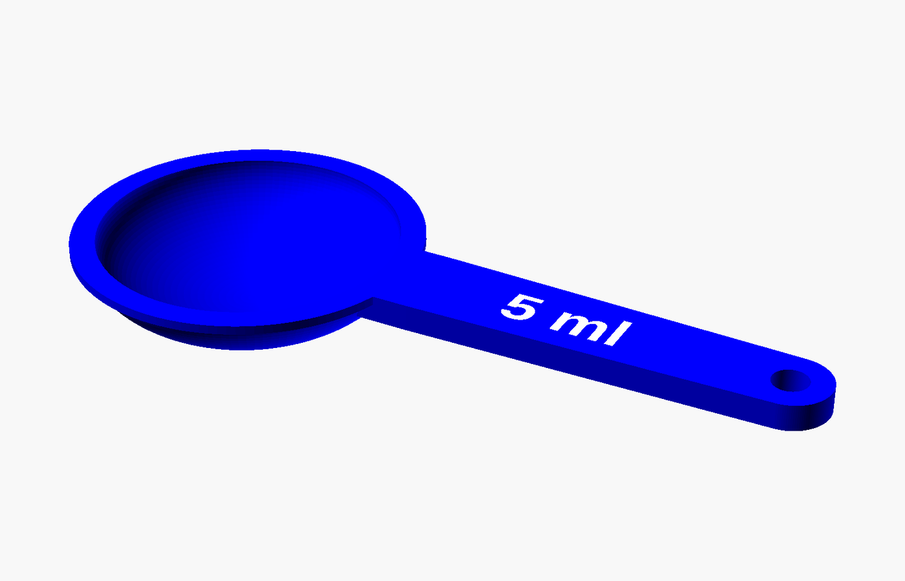
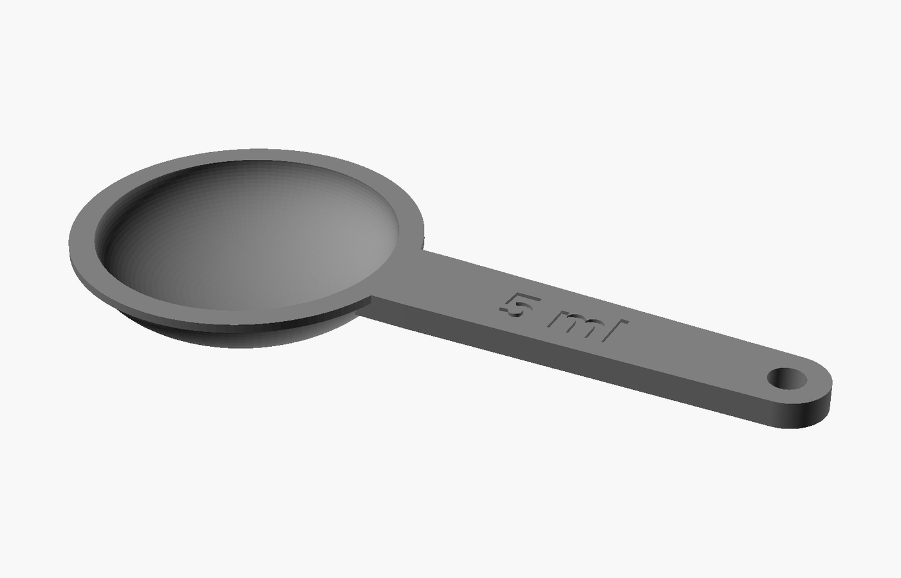
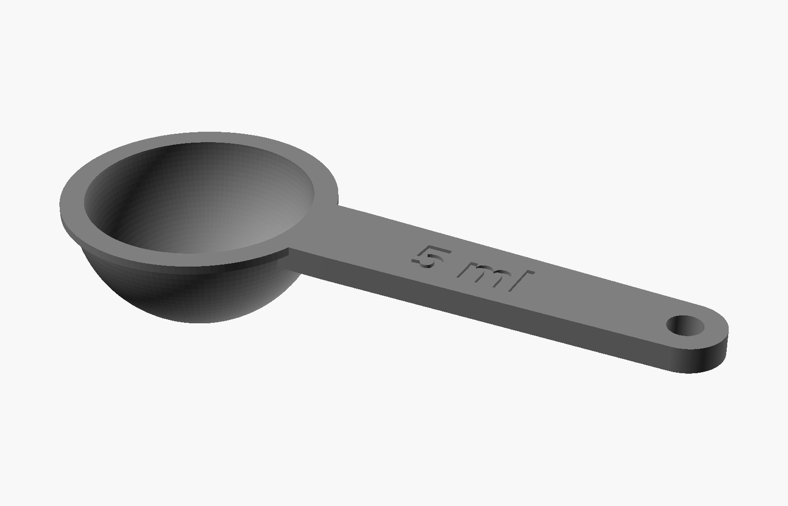
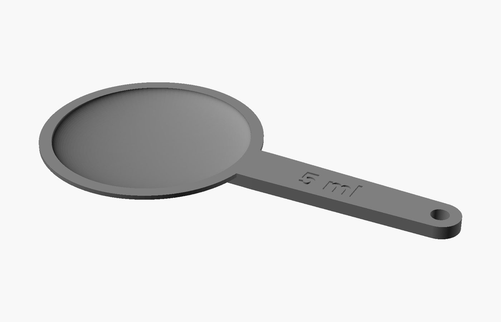
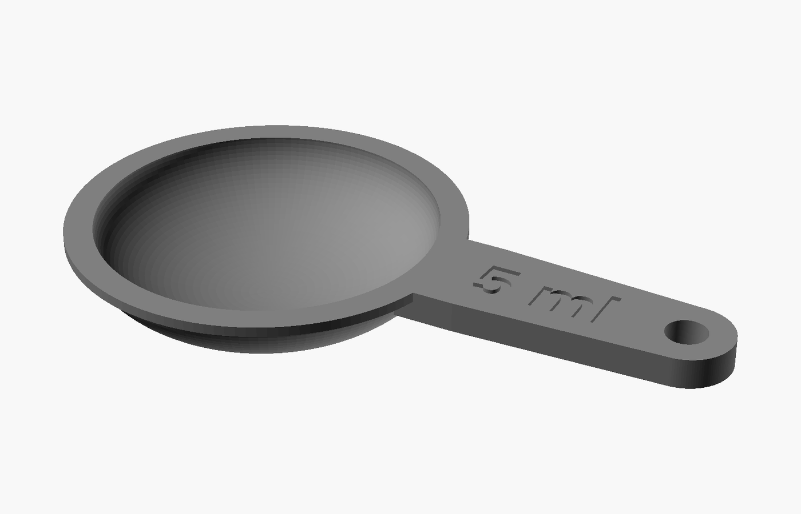
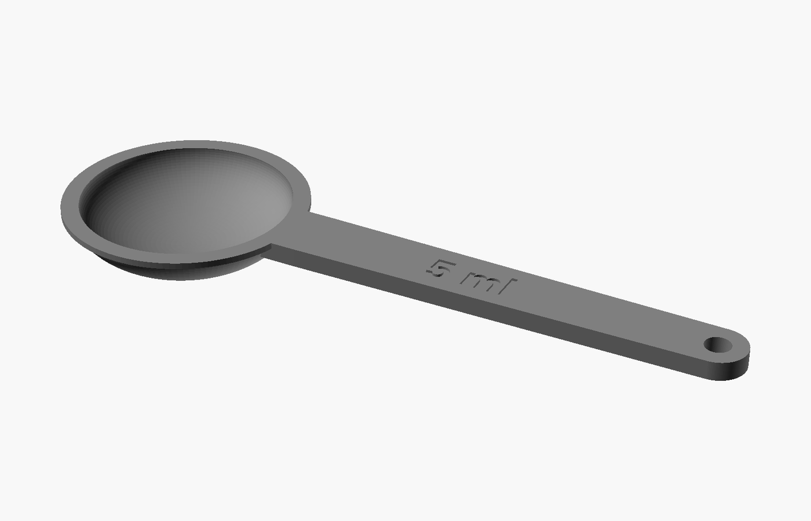

# measuringSpoon

<p align="center">
  
</p>

<p align="center"><em>5 ml spoon in blue with a white engraved inlay
(<code>volumeMode = "volume"</code>, <code>volumeCm3 = 5</code>,
<code>spoonColor = "blue"</code>, <code>textColor = "white"</code>,
<code>showLabel = "colored"</code>).</em></p>

A parametric measuring spoon you can generate for an exact volume — or for an
exact weight of a given ingredient — with a printable, colour-fillable label on
the handle.

The spoon is a single printable part: a half-ellipsoid bowl (flat, level rim
with a small lip), a flat handle with an optional hanging hole, and an optional
engraved or two-colour label showing what the spoon measures.

- **One file:** `measuringSpoon.scad`
- **Designed for:** OpenSCAD 2021.01 or newer
- **Units:** millimetres, grams, g/cm³, cm³ (ml)
- **Printing:** bowl opening down (rim and handle on the build plate)

---

## Quick start

1. Open `measuringSpoon.scad` in OpenSCAD.
2. If the **Customizer** panel is not visible, enable it with
   *View → Customizer*. All user parameters are exposed there with dropdowns
   and numeric fields.
3. Pick what you want to measure:
   - **By volume:** set `volumeMode = "volume"` and enter `volumeCm3`
     (1 cm³ = 1 ml).
   - **By weight:** set `volumeMode = "grams"`, enter `gramsPerSpoon` and the
     ingredient's `density`.
4. Press `F5` to preview and check the size and label in the console at the
   bottom of the window (*View → Hide/Show Console* if it is hidden) and in the
   3D view.
5. Press `F6` for a full render, then *File → Export → Export as STL*.
   Save it.
6. In your slicer, flip the spoon over so the **bowl opening faces the build
   plate** and the rim and handle sit flat on the bed. Slice and print — see
   [Printing](#printing) for supports and label notes.

A 5 g water spoon is the default: `volumeMode = "grams"`, `density = 1.0`,
`gramsPerSpoon = 5`.

---

## How the volume is defined

The bowl interior is a half-ellipsoid filled exactly to the flat rim plane:

```
V = (2/3) * π * r² * d
```

- `r` = bowl **interior** radius (half of the rim opening)
- `d` = bowl interior depth
- A spoon filled level with the rim holds **V** millilitres (cm³)

The generated geometry is compensated for the polygonal approximation of the
curved bowl, so the mesh you export matches the requested volume rather than
the slightly smaller faceted mesh a plain sphere approximation would give.
Because a printed spoon is also
affected by extrusion width, layer squish and material shrinkage, there is a
`volumeCorrection` calibration factor (see [Accuracy and calibration](#accuracy-and-calibration)).

**Level, not heaped.** The model assumes the ingredient is struck off level
with the rim. A heaped spoon holds noticeably more, especially with powders.

---

## Parameters

All parameters live at the top of `measuringSpoon.scad`, grouped as they
appear in the Customizer. The *Hidden* group is normally not shown; set
`debugInterior`, `volumeCorrection`, `$fn` and friends directly in the file
when you need them.

### Volume

| Parameter | Default | Unit | Meaning |
|---|---|---|---|
| `volumeMode` | `"grams"` | choice | `Grams` or `Volume` — how the target is specified |
| `density` | `1.0` | g/cm³ | Ingredient density, used only in Grams mode |
| `gramsPerSpoon` | `5` | g | Target weight of one level spoon |
| `volumeCm3` | `1` | cm³ | Target volume of one level spoon (1 cm³ = 1 ml) |

**`volumeMode`** chooses which of the two targets is active. Only one is used;
the other is ignored (and can be left at its default).

- `"grams"` — you want a spoon that holds *N grams* of a particular
  ingredient. The spoon volume becomes `gramsPerSpoon / density`.
- `"volume"` — you want a spoon that holds *N millilitres*, regardless of
  ingredient. The spoon volume becomes `volumeCm3`.

**`density`** is the bulk (poured/scooped) density of the ingredient, not the
particle density. Approximate values for common ingredients:

| Ingredient | Density (g/cm³) |
|---|---|
| Water, milk | 1.0 |
| Sugar (granulated) | 0.85 |
| Salt (fine table) | 1.2 |
| Flour (sifted/aerated) | 0.55 |
| Rice (uncooked) | 0.85 |
| Cocoa powder | 0.5 |
| Coffee (ground) | 0.4 |

Powders vary a lot with how they are packed and how coarse they are, so treat
these as starting points. If the weight matters, weigh a test spoonful and
adjust `density` (or use `volumeCorrection`) until it comes out right. For a
spoon that should be right for *any* ingredient, use Volume mode and measure
with a jug.

**`gramsPerSpoon`** is only used in Grams mode. The label shows this value
automatically (e.g. `5 g`).

**`volumeCm3`** is only used in Volume mode. The label shows it automatically
with an `ml` suffix (e.g. `1 ml`), since 1 cm³ = 1 ml. Values do not have to be
whole numbers; `2.5` gives a 2.5 ml spoon.

### Bowl

| Parameter | Default | Unit | Meaning |
|---|---|---|---|
| `bowlMode` | `Proportional` | choice | `Proportional` or `Fixed diameter` |
| `depthRatio` | `0.5` | ratio | Bowl depth ÷ interior radius (Proportional mode) |
| `bowlDiameter` | `25` | mm | Rim diameter of the bowl *interior* (Fixed diameter mode) |
| `wallThickness` | `1.6` | mm | Bowl wall thickness |
| `rimLip` | `1.2` | mm | Width of the flat rim lip around the opening |

**`bowlMode`** decides whether the script chooses the bowl width for you or
you choose it and the script works out the depth from the target volume.

- `Proportional` (the default) — the **diameter is derived** from the volume and
  `depthRatio`. Bigger volumes automatically produce bigger bowls. This is the
  usual choice.
- `Fixed diameter` — you set `bowlDiameter`, and the **depth is derived** from
  the volume. Use this when the spoon has to fit a specific jar, drawer or set
  (for example, matching the diameter of an existing spoon).

**`depthRatio`** (Proportional mode only) sets the shape of the bowl: `d =
depthRatio × r`. It controls how shallow or deep the spoon feels:

- `0.5` (default) — a fairly shallow, wide spoon that is easy to level and
  scoop with.
- `1.0` — a hemispherical bowl, deeper and narrower for the same volume.
- below `0.4` — very flat, almost a ladle/scuttle; large in diameter.
- much above `1.0` — a deep cup-like bowl, harder to fill and level.

In Proportional mode this value sets only the *shape*; the bowl diameter then
follows from the target volume and always adjusts to keep the volume constant.
The console always echoes the resulting radius, diameter and depth.

**`bowlDiameter`** (Fixed diameter mode only) is the **inside** diameter at
the rim, in millimetres. The outside diameter is this plus twice
`wallThickness`. If you make the diameter large compared to the target volume,
the computed depth becomes very small and the script stops with an error —
increase the volume or decrease the diameter. Conversely, a tiny diameter with
a large volume gives an impractically deep bowl and also errors out.

**`wallThickness`** is the bowl shell thickness, measured at the rim. `1.6 mm`
is four 0.4 mm perimeters: stiff enough for a spoon, and the default. Use
`1.2 mm` for a lighter spoon (three perimeters) or `2.0 mm` and up for a very
sturdy one or a large volume. It affects the outside size only — the interior,
and therefore the volume, is unchanged.

**`rimLip`** adds a flat annular lip around the opening, flush with the fill
line. It gives you a clean surface to strike the ingredient off against and
stiffens the rim. It extends **outward** from the outer wall by this many
millimetres, so the overall bowl width is increased by twice this value. Set it
to `0` to remove the lip completely, or around `0.8–2.0` for a practical
spoon. Very large values on a small bowl look clumsy.

### Handle

| Parameter | Default | Unit | Meaning |
|---|---|---|---|
| `handleLength` | `45` | mm | From the outer bowl edge to the centre of the rounded end |
| `handleWidth` | `11` | mm | Handle width where it meets the bowl |
| `handleTipWidth` | `9` | mm | Handle width at the rounded end |
| `handleThickness` | `3` | mm | Handle thickness |
| `handleHole` | `true` | on/off | Add a hanging hole in the tip |
| `handleHoleDia` | `4` | mm | Hanging hole diameter |

The handle tapers smoothly from `handleWidth` at the bowl to `handleTipWidth`
at the tip, with a fully rounded end. Its top surface is level with the rim
(for a natural scooping angle) and its root is embedded in the bowl wall, so it
never takes volume out of the bowl.

**`handleLength`** is measured along the spoon from the **outside of the bowl**
to the **centre of the rounded tip**, so the overall length of the spoon is
`2 × outer bowl radius + rimLip + handleLength + half the tip width`. A 45 mm
handle plus a 5 g bowl gives about 88 mm overall. Shorten it to about 25–30 mm
for a compact/pocket spoon; lengthen to 70 mm+ for a long-reach jar spoon. Very
long handles with a thick, wide profile become rigid; keep `handleThickness`
around `2.5–4 mm` for a good stiffness/weight balance.

**`handleWidth`** and **`handleTipWidth`** set the profile. A wider root
(`handleWidth`) spreads the load where the handle meets the bowl; a narrower
tip feels more comfortable in the fingers. Setting the tip width equal to or
larger than the root gives a straight or flared handle.

**`handleThickness`** is the vertical thickness. The handle prints flat with
its layers stacked through the thickness, so layer adhesion matters here; 3 mm
at 0.2 mm layers is 15 layers. Keep it thick enough to feel solid but not so
thick that the spoon becomes top-heavy.

**`handleHole`** and **`handleHoleDia`** add a round hole through the tip for a
string, ring or hook. The hole is placed in the centre of the rounded end. It
is automatically skipped (with a warning in the console) if the tip is too
narrow to leave a wall around it, or if the handle is too short for the hole to
clear the bowl. If that happens, either widen `handleTipWidth`, lengthen
`handleLength`, or reduce `handleHoleDia`. Usable hole sizes are roughly
`3–5 mm`; `4 mm` fits most kitchen string and small hanging hooks.

### Label

| Parameter | Default | Unit | Meaning |
|---|---|---|---|
| `showLabel` | `"cut"` | choice | `No label`, `Cut/engraved`, or `Colored inlay` |
| `labelText` | `""` | text | Custom text; blank = automatic label |
| `labelSize` | `5` | mm | Text height (cap height, roughly) |
| `labelDepth` | `0.4` | mm | Engraving depth |
| `labelOverlap` | `0.05` | mm | Coloured inlay extension into the body |
| `labelRecess` | `0.005` | mm | Coloured inlay sits this far below the surface |
| `labelFont` | `"Liberation Sans:style=Bold"` | font | Font used for the label |

The label is engraved on the **top of the handle**, centred across the handle
width and set along its length, reading along the spoon. "Top" here means the
face that is level with the rim — the side you see when the bowl is turned
up for use. In the recommended print orientation (bowl down) that face lies on
the build plate, so the label is printed first, face-down.

**`showLabel`**:

- `"none"` — plain handle, nothing engraved.
- `"cut"` — the text is engraved into the handle. The recess shows in the body
  colour, so the label is subtle and survives wear. This is the default.
- `"colored"` — the text is engraved and a second solid inlay is generated in
  `textColor`, flush with the handle surface. This is for multi-material
  printers (or a slicer with colour-by-object), giving a high-contrast label.

With `"colored"`, the inlay is a separate object in the model. In OpenSCAD and
in a 3MF export it can be assigned the second colour; if you export a single
STL you get one merged solid with no colour. On a single-material printer the
inlay simply fills the groove in the body colour, so use `"cut"` there instead —
the coloured inlay needs a second material to be visible. `labelOverlap` and
`labelRecess` are fine-tuning values for the inlay fit: `labelOverlap` makes
the inlay slightly wider and deeper than the groove so it fuses into the body
without a hairline gap, and `labelRecess` keeps its top a few microns below the
surface so the slicer does not see two coplanar surfaces. You should not need
to change them; increase `labelOverlap` slightly only if the inlay separates
from the body in your slicer, and never set `labelRecess` to `labelDepth` or
above.

**`labelText`** overrides the automatic label. Leave it empty (`""`) and the
spoon labels itself:

- Grams mode → the weight, e.g. `5 g`
- Volume mode → the volume in ml, e.g. `1 ml`

Set it to anything you like — `"TSP"`, `"SALT"`, `"1/2 tsp"`, `"Coffee"`,
even a name. Keep the text short: it does not wrap, shrink or clip
automatically, and text longer than the handle will stick out past the tip or
over the bowl. If it does not fit, increase `handleLength`/`handleWidth`,
reduce `labelSize`, or shorten the text.

**`labelSize`** is the font size in millimetres. `5` is comfortable on an
11 mm handle. It must leave at least a millimetre or so of handle on either
side of the text; reduce it for long labels or narrow handles, and increase it
(and the handle size) for a label that is easy to read at a glance.

**`labelDepth`** is how deep the engraving goes. `0.4 mm` is two 0.2 mm layers
— clearly visible and easy to fill. It must be less than `handleThickness`, and
with the coloured inlay it defines the inlay thickness. Use `0.6 mm` for a
deeper, more tactile cut, or `0.2 mm` for a barely-there marking. If you print
with a larger nozzle or layer height, keep it at least as deep as one layer so
the engraving does not disappear.

**`labelFont`** is any font family name known to OpenSCAD, in
`"Family:style=Style"` form. The default `Liberation Sans:style=Bold` is
available on most Linux systems. On Windows or macOS, or if the text does not
appear at all, pick a font that exists on your machine — for example
`"Arial:style=Bold"` or `"DejaVu Sans:style=Bold"`. *Help → Font List* lists
all installed fonts. A bold font reads much better at small sizes.

### Color

| Parameter | Default | Unit | Meaning |
|---|---|---|---|
| `spoonColor` | `"white"` | choice | Body colour |
| `textColor` | `"black"` | choice | Inlay colour for `showLabel = "colored"` |

Both are chosen from a palette of 20 named colours (white, ivory, silver, gray,
black, red, orange, gold, yellow, lime, green, olive, teal, aqua, blue, navy,
purple, violet, pink, brown). They are cosmetic:

- They colour the OpenSCAD preview and are kept in a **3MF** export, which is
  the format to use for multi-material printing.
- An **STL** export has no colour information at all; the printed colour is
  whatever filament you load.
- Use `textColor` (contrasting with `spoonColor`) for a readable inlay.

### Hidden / advanced

These are in the **Hidden** group. The defaults are correct for normal use;
they are documented here so you know what they do before changing them.

| Parameter | Default | Meaning |
|---|---|---|
| `lipThickness` | `1.0` mm | Vertical thickness of the flat rim lip |
| `previewDrop` | `0.00005` mm (preview only) | Lowers the lip in preview to avoid z-fighting |
| `handleDrop` | `0.0001` mm (preview only) | Lowers the handle top in preview to avoid z-fighting |
| `debugInterior` | `false` | Show the cavity as a solid orange plug instead of the spoon |
| `compensateFaceting` | `true` | Pre-inflate the bowl so the exported mesh matches the target volume |
| `volumeCorrection` | `1.0` | Global volume multiplier for print calibration |
| `$fn` | `128` | Number of facets on the curved surfaces |

**`debugInterior`** renders only a solid orange half-ellipsoid of the cavity.
Slice it and let the slicer report its volume — it should match the requested
volume shown in the console. Use it to verify a calibration, then set it back
to `false` before exporting the real spoon.

**`compensateFaceting`** corrects for the fact that a faceted sphere encloses
slightly less volume than the ideal one. With `$fn = 128` the shortfall is only
about 0.1 %, but it grows quickly at low facet counts. Leave it on unless you
specifically want the un-corrected analytic shape. It stays correct if you
change `$fn`, and it is disabled automatically when `$fn = 0` (OpenSCAD's "use
`$fa`/`$fs`" mode).

**`volumeCorrection`** multiplies the requested volume. It is the calibration
knob for real prints: if your printed spoons consistently hold a little less
than intended, set it to e.g. `1.03` for 3 % more. This changes the bowl size
slightly, not the label.

**`$fn`** sets the smoothness of the bowl and hanging hole. `128` gives a
smooth bowl at normal sizes. Lower it (e.g. `64`) for faster previews on a slow
machine; below roughly `32` the bowl becomes visibly polygonal. The faceting
compensation adjusts automatically to whichever value you use.

**`previewDrop` / `handleDrop` / `lipThickness`** are internal geometry
details. The drops only apply in the OpenSCAD preview (`$preview`) to stop
coplanar faces from flickering; during a full render (`F6`) they are zero so
the exported model remains exactly flush. Leave them alone.

---

## Examples

All examples use the default 45 mm handle, `depthRatio = 0.5`, and
`wallThickness = 1.6 mm`, so you can see how the bowl grows with the target.

| What you want | Settings | Approx. bowl dia × depth | Overall length |
|---|---|---|---|
| 1 ml / 1 g water | `volumeMode = "volume"`, `volumeCm3 = 1` | 19.7 × 4.9 mm | ~74 mm |
| 2.5 ml | `volumeMode = "volume"`, `volumeCm3 = 2.5` | 26.7 × 6.7 mm | ~81 mm |
| 5 g water | `volumeMode = "grams"`, `density = 1.0`, `gramsPerSpoon = 5` | 33.7 × 8.4 mm | ~88 mm |
| 5 g sugar | `density = 0.85`, `gramsPerSpoon = 5` | 35.6 × 8.9 mm | ~90 mm |
| 5 g salt | `density = 1.2`, `gramsPerSpoon = 5` | 31.7 × 7.9 mm | ~86 mm |
| 5 g flour | `density = 0.55`, `gramsPerSpoon = 5` | 41.1 × 10.3 mm | ~95 mm |
| 1 tablespoon | `volumeMode = "volume"`, `volumeCm3 = 15` | 48.6 × 12.1 mm | ~103 mm |

Bowl sizes are interior; add `2 × wallThickness` for the outside, plus
`2 × rimLip` at the rim. Making a set? Generate each spoon with the same
`bowlMode`, `depthRatio`, `wallThickness`, handle settings and colours, and
only change the volume — they will look like a matched set. If you want every
spoon in the set to have the **same bowl diameter** (e.g. to stack or to fit a
holder), set `bowlMode` to `Fixed diameter` with a common `bowlDiameter`; the
depths will then differ instead.

---

## Sample renders

All sample spoons are **5 ml** (`volumeMode = "volume"`, `volumeCm3 = 5`) and
use the default settings except for the parameter shown in each caption. The
bowl and handle samples use `spoonColor = "gray"` and the default engraved
label; the image at the top of this README shows the coloured inlay.

### Bowl shape

| `depthRatio = 0.5` (default) | `depthRatio = 1.0` | Fixed diameter, `bowlDiameter = 45` |
|---|---|---|
|  |  |  |
| 33.7 mm diameter × 8.4 mm deep — wide, shallow and easy to level. | 26.7 mm diameter × 13.4 mm deep — same volume, deeper and narrower. | 45 mm diameter × 4.7 mm deep — the width is fixed, so the depth follows from the volume. |

### Handle length

| `handleLength = 25` (short) | `handleLength = 45` (default) | `handleLength = 70` (long) |
|---|---|---|
|  |  |  |
| Compact spoon, about 68 mm overall. | Standard spoon, about 88 mm overall. | Long-reach spoon, about 113 mm overall, for deep jars. |

### Label

| `showLabel = "cut"`, `labelSize = 7` | `showLabel = "colored"`, `labelText = "TSP"` |
|---|---|
|  |  |
| Engraved in the body colour with a larger 7 mm font. | Two-colour inlay: 6 mm "TSP" in yellow on a navy handle (`spoonColor = "navy"`, `textColor = "yellow"`). |

---

## Printing

- **Orientation:** turn the exported spoon over so the **bowl opening faces the
  build plate**. The flat rim lip and the whole handle then rest directly on the
  bed — the largest possible first-layer footprint — while the outer dome of the
  bowl grows upward and the handle is no longer a cantilever. The model is
  exported bowl-up, so flip it 180° in the slicer (or use the slicer's "lay
  flat" tool on the rim) before slicing.
- **Supports:** generally none. The handle and rim sit on the plate and need no
  support. The only overhanging area is the **inside of the bowl**, which is now
  a shallow ceiling: it curves inward gradually from the vertical rim, so the
  overhang steepens only as the remaining opening shrinks, and the final
  closure is a short bridge. Most printers handle this unsupported, with at
  most a little roughness on the inside top. If your printer sags overhangs, or
  you print a very wide/shallow bowl (a large `bowlDiameter` for the volume, or
  `depthRatio` below ~0.4), enable supports **inside the bowl only** —
  build-plate supports, removable through the opening afterwards — and expect
  some marks on the measuring surface. Deeper bowls (`depthRatio` closer to or
  above 1.0) are easier in this orientation than shallow ones.
- **Label:** the label is on the same face as the rim, so it is printed
  **face-down** and forms part of the first layers. Use a smooth build plate
  for the cleanest label face, and keep first-layer squish moderate so the fine
  grooves do not close up. Once the spoon is turned bowl-up for use, the
  engraving is on top exactly as intended.
- **Layer height:** 0.2 mm is a good default. Use 0.12–0.16 mm if you want a
  smoother bowl and a crisper label.
- **Perimeters:** 3–4. With the default 1.6 mm wall and a 0.4 mm nozzle, four
  perimeters make the bowl wall solid.
- **Infill:** 15–25 % is plenty; the bowl wall is already solid from
  perimeters.
- **Coloured label:** with `showLabel = "colored"`, the inlay is a separate
  object printed in the first layers (it starts at the bed with the label). Use
  a multi-material printer, or a slicer with "colour by object" and a 3MF
  export, and assign the inlay to `textColor`. A single mid-print filament swap
  colours whole layers and cannot isolate the text.
- **Material:** PLA is fine for dry ingredients and general kitchen use; PETG
  is tougher and more heat-resistant. **FDM prints are porous and not
  certified food-safe** — especially with printed-in crevices — so use a
  food-safe filament if that matters to you, hand-wash and dry the spoon
  rather than dishwashing it, and avoid it for very hot or oily foods.

---

## Accuracy and calibration

The model is dimensionally exact for its intended volume (after faceting
compensation), but printed volume is not only geometry: extrusion width,
elephant's foot, layer squish, shrinkage and the faceted surface all shift it
slightly. In the recommended bowl-down orientation, the inside top of the bowl
is also the last part of the cavity to form, as a shallow overhang: if it sags,
the spoon holds slightly less. Keep part cooling on, consider supports inside
the bowl if the ceiling comes out rough, and calibrate the result. To check and
correct a real spoon:

1. Generate a spoon and set `debugInterior = true`. Slice it and compare the
   slicer's volume report with the console's `Requested volume`.
2. Print the actual spoon and measure it with water on a scale: put the dry
   spoon on the scale, tare it, fill the bowl level with the rim (a dropper
   helps), and read the weight in grams — 1 g of water ≈ 1 ml.
3. If the measured volume is consistently low, raise `volumeCorrection` by the
   same ratio (e.g. measured 4.8 ml instead of 5 → `1.0 × 5 / 4.8 ≈ 1.04`).
   If it is high, lower it below `1.0`.

Because `volumeCorrection` alters the bowl size, the label still shows the
nominal value — which is what you want for a calibrated spoon. Keep your
calibrated values recorded next to the STL if you plan to reprint.

The console echoes the active numbers every render:

```
Requested volume : 5 cm3 (5000 mm3)
Bowl radius      : 16.84 mm  (diameter 33.68 mm)
Bowl depth       : 8.42 mm
Faceting factor  : 0.998996 at $fn=128 (mesh matches requested volume)
```

---

## Using it without the GUI (CLI)

Every Customizer parameter can be overridden from the command line with `-D`,
which is handy for generating a whole set:

```bash
openscad -o spoon-5g-water.stl \
  -D 'volumeMode="grams"' -D 'density=1.0' -D 'gramsPerSpoon=5' \
  measuringSpoon.scad

openscad -o spoon-1ml.stl \
  -D 'volumeMode="volume"' -D 'volumeCm3=1' \
  measuringSpoon.scad

openscad -o spoon-salt.stl -D 'labelText="SALT"' -D 'textColor="blue"' \
  -D 'gramsPerSpoon=5' -D 'density=1.2' \
  measuringSpoon.scad
```

Use `-o spoon.3mf` instead of `.stl` to keep the colours. Add `-D 'debugInterior=true'`
to export the cavity plug for verification.

---

## Troubleshooting

| Symptom | Cause / fix |
|---|---|
| "Computed bowl depth is too small" | Fixed diameter mode with a diameter too large for the volume. Increase the volume or decrease `bowlDiameter`, or switch `bowlMode` to Proportional. |
| "Computed bowl depth is unrealistically large" | Fixed diameter mode with a diameter too small for the volume. Increase `bowlDiameter`, reduce the volume, or switch to Proportional mode. |
| "Target volume must be greater than 0" | `gramsPerSpoon` or `volumeCm3` is zero/negative, or `density` is invalid in Grams mode. |
| No text in the model | The font is not installed. Change `labelFont`, or check *Help → Font List*. |
| Text sticks out past the handle | Label too long or too large. Shorten `labelText`, reduce `labelSize`, or lengthen/widen the handle. |
| Hanging hole missing | Console warns that the tip is too small or the handle too short. Widen `handleTipWidth`, lengthen `handleLength`, or shrink `handleHoleDia`. |
| Engraving invisible after printing | `labelDepth` is thinner than a layer. Use at least one layer height (0.2–0.4 mm). |
| Preview flickers / faces look covered | This is an OpenCSG preview artefact; the preview offsets handle the common cases. Press `F6` for a full render before judging. |
| Coloured inlay not visible in a 3MF | Check that `showLabel = "colored"`, the objects are assigned different materials, and `spoonColor`/`textColor` differ. |
| Spoon holds slightly the wrong amount | Calibrate with `volumeCorrection` as described above. |
| Inside top of the bowl is rough or the volume is low | In the bowl-down orientation the inside ceiling is an overhang. Improve part cooling, lower the layer height, or enable supports inside the bowl, then recalibrate. |
| Model looks faceted | Increase `$fn` (e.g. 128 or 256) and re-render with `F6`. |

---

## Files

- `measuringSpoon.scad` — the parametric model (everything is in this file)
- `render/` — the sample renders shown in this README
- `tools/` — helper scripts, including the Markdown-to-PDF builder
- `README.md` — this document
- `Manual.pdf` — generated PDF version of this README
- `LICENSE.md` — MIT licence

## License

MIT — see [LICENSE.md](LICENSE.md). Copyright (c) 2026 Michael Wolf.

## Manual (PDF)

`Manual.pdf` is a printable PDF build of this README, including the sample
renders. Regenerate it from the repository root with:

```bash
./tools/build-manual.sh
```

The script uses `tools/md2pdf.py` and `uv`; Python dependencies are downloaded
and cached on first use. See [tools/README.md](tools/README.md) for options and
details.
